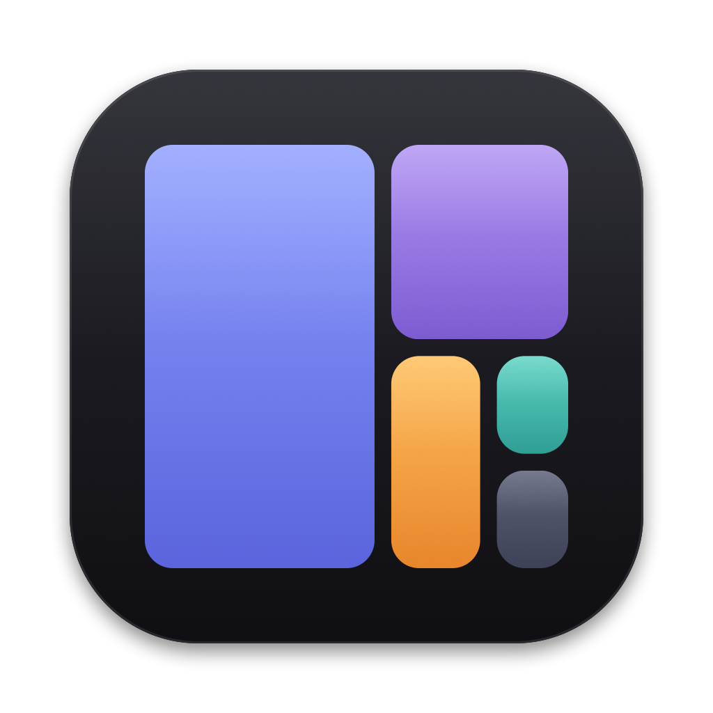
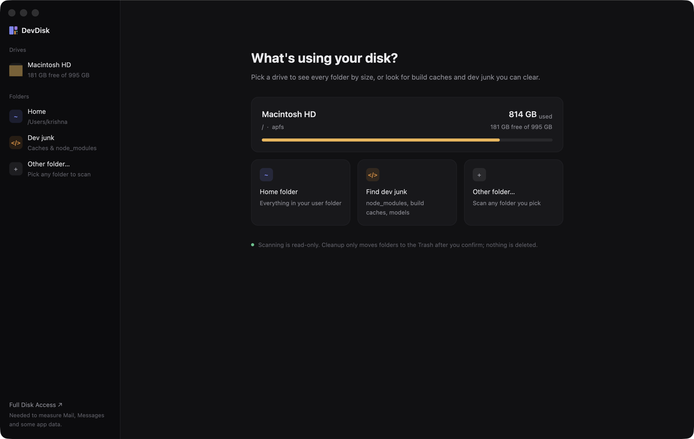

<p align="center"></p>

<h1 align="center">DevDisk</h1>

[](https://github.com/entange/dev-disk/actions/workflows/ci.yml)
[](https://github.com/entange/dev-disk/releases/latest)
[](LICENSE)

A fast macOS disk-space viewer (like CleanMyMac's Space Lens) built with Rust + [GPUI](https://www.gpui.rs), with a separate, safety-first cleanup view for dev/AI junk: `node_modules`, `target`, DerivedData, venvs, model caches and more.



## Install

Download **DevDisk-x.y.z.dmg** from the [latest release](https://github.com/entange/dev-disk/releases/latest), open it and drag DevDisk into Applications. It's a universal app (Apple silicon + Intel) and needs macOS 13 or later.

### First launch

Release builds are ad-hoc signed, not notarized, so macOS will say it "can't be opened" the first time. Either right-click DevDisk in Applications → **Open** → **Open**, or run:

```sh
xattr -dr com.apple.quarantine /Applications/DevDisk.app
```

To measure protected folders (Mail, Messages, some app containers), grant **Full Disk Access** to DevDisk in System Settings → Privacy & Security. The sidebar has a link that opens that page.

## Build from source

Needs a Rust toolchain and Xcode (for the Metal shader compiler).

```sh
./bundle.sh                 # -> dist/DevDisk.app (ad-hoc signed, with icon)
open dist/DevDisk.app
# or: cargo run --release

UNIVERSAL=1 PACKAGE=1 ./bundle.sh   # universal app + dist/DevDisk-<version>.dmg/.zip
```

The app icon is drawn by `assets/make_icon.swift`; run `assets/make_icns.sh` to redraw `assets/icon_1024.png`. `bundle.sh` turns that PNG into `AppIcon.icns`.

## What it does

- **Drives**: lists every mounted volume with its used and free space. Click one to scan it.
- **Space Lens**: shows every folder and every large file, sorted by size. There's a list on the left and a two-level squarified treemap on the right. Click to drill in, use the breadcrumbs or ↑ to go back up, and ↗ to reveal an item in Finder. Small files are grouped into a "N smaller files" row. Colours: folders are blue, dev junk is orange, and media, archives, models and data each get their own colour.
- **Dev Cleanup**: lists dev/AI folders that can be regenerated, grouped by ecosystem (JS/Node, Rust, Python, Xcode, Gradle/Maven, Go, Flutter, Homebrew, AI models, editor caches and so on). Each one gets a risk badge:
  - **Safe**: rebuilt automatically (node_modules, .next, .turbo, target, DerivedData, `__pycache__`, …)
  - **Review**: needs a re-download or re-install (venvs, HF/Ollama models, Pods, Maven repo, …)
  - **Info only**: shown so you know about it, but it can never be removed here (Docker disk image, simulators, rustup toolchains, Android SDK)
- The status bar shows how much used space the scan couldn't see (APFS snapshots, purgeable space, system data, folders it had no access to).

## Speed

- Uses `getattrlistbulk(2)`: one syscall returns the names, types and allocated sizes for a whole batch of directory entries, so there's no `lstat` per file.
- Spreads the work over a rayon work-stealing pool with 2× the core count, capped at 32 threads.
- Counts allocated size, matching `du`. Hard links are counted once. Symlinks are never followed and the scan never crosses into another volume.

## Safety model

`src/trash.rs` is the only code that changes anything on disk. These rules hold:

1. **Nothing is ever permanently deleted.** Items go to the macOS Trash through `NSFileManager trashItemAtURL`. There is no `remove_dir_all` (or anything like it) in the codebase.
2. **Space Lens cannot remove anything.** It can only reveal items in Finder.
3. Dev rules are strict. For example, `node_modules` only counts if there's a `package.json` next to it, and `target` only counts if there's a `Cargo.toml` next to it *and* a `.rustc_info.json`/`CACHEDIR.TAG` inside it. Name-based rules only apply inside your home folder (or an external drive). They never apply inside `~/Library`, `~/Applications`, hidden top-level folders (`~/.vscode`, `~/.nvm`, …) or app bundles. Global caches are matched by their exact path only.
4. Only the top-most match is listed. Nested `node_modules` belong to their parent.
5. Nothing is selected until you select it. You then get a confirmation dialog that lists every path. Its button stays disarmed for ~1 second and only responds to a real mouse click.
6. **Every item is checked again right before it's moved**:
   - its path must be canonical (no symlinks)
   - it must be a real folder
   - it must be at least two levels inside your home folder or an external volume
   - it must not be in a protected location (iCloud Drive, CloudStorage, Keychains, Mail, `.ssh`, …)
   - its rule is re-checked against the disk as it is now

   If any of these checks fails, the item is skipped and the app tells you why.
7. Every move is logged to `~/Library/Logs/DevDisk/trash.log` with the original path and the Trash location.

The disk space comes back only after **you** empty the Trash.

## Tests

`cargo test --release` runs read-only checks:
- scanner totals vs `du` (set `DEVDISK_TEST_DIR` to compare against another folder)
- rule matching on a throwaway fixture in `target/devdisk-fixture`
- the path guard rails

The tests never call the Trash code.

## Releasing

1. Bump `version` in `Cargo.toml` (and run `cargo build` so `Cargo.lock` follows).
2. Add a `## x.y.z` section to `CHANGELOG.md`.
3. Commit, then `git tag vx.y.z && git push origin main vx.y.z`.

[`release.yml`](.github/workflows/release.yml) builds the universal app, then publishes a GitHub release with the `.dmg`, `.zip` and `SHA256SUMS.txt`, using the changelog section as the notes. If the `MAC_CERTIFICATE_P12_BASE64`, `MAC_CERTIFICATE_PASSWORD` and `MAC_SIGN_IDENTITY` secrets are set it signs with a Developer ID, and with `APPLE_ID`, `APPLE_APP_SPECIFIC_PASSWORD` and `APPLE_TEAM_ID` it also notarizes.

## License

[MIT](LICENSE)
